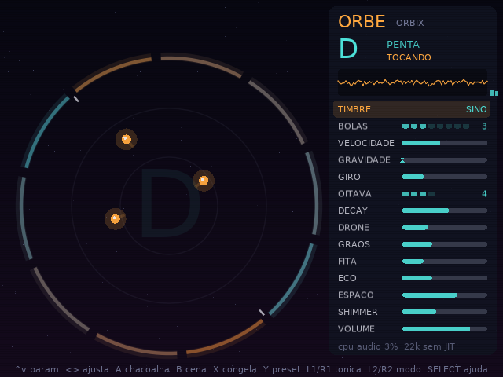

# ORBE

**Sintetizador generativo para o console portátil R36S (ArkOS)**: bolas quicam dentro de um anel e cada batida toca uma nota da escala, envolvida por texturas de drone, grãos, eco, reverb com *shimmer* e emulação de fita.

Feito para gerar fundos ambientes e cinematográficos para tocar junto com outro instrumento (por exemplo, um sintetizador FM): você escolhe a tônica e a escala, e o ORBE fica tocando na mesma tonalidade.



🔊 **Ouça uma prévia:** [`docs/audio/previa.mp3`](docs/audio/previa.mp3). São 80 s gerados pelo próprio motor, passando pelos presets ORBIX → DUNA → BLADE RUNNER → CRISTAL.

---

## Recursos

- **Anel generativo**: de 1 a 8 bolas com física (velocidade, gravidade, giro do anel). Cada segmento colorido do anel é uma nota da escala em duas oitavas.
- **4 timbres FM**: SINO, VIDRO, CORDA e SOPRO.
- **Texturas**: drone grave, nuvem de grãos (inclusive uma oitava acima e abaixo), eco *ping-pong*, reverb com *shimmer* (+1 oitava) e fita (wow, flutter, chiado e saturação).
- **7 escalas**: menor, dórico, frígio, lídio, maior, pentatônica e hirajoshi, nas 12 tônicas.
- **6 presets**: ORBIX, DUNA, BLADE RUNNER, CRISTAL, FITA VELHA e OCEANO. Também gera cenas aleatórias.
- **Interativo**: o analógico esquerdo inclina a gravidade do anel; dá para chacoalhar as bolas e congelar os grãos.
- **Feito para hardware fraco**: o áudio roda numa thread própria e o app se **calibra sozinho** ao abrir. Ele escolhe entre JIT ligado ou desligado, taxa de 22, 16 ou 11 kHz e o modo leve para não picotar.
- Salva tudo automaticamente em `config.txt`.

## Requisitos

| Item | Detalhe |
|---|---|
| Console | R36S (RK3326) ou outro portátil Linux aarch64 com PortMaster |
| Sistema | ArkOS, testado. Outros CFWs com PortMaster devem funcionar. |
| Motor | **LÖVE 11.5**, vindo do port **Balatro** (`ports/balatro`) ou do runtime `love_11.5` do PortMaster |

> O ORBE **não inclui** o LÖVE nem nenhum arquivo do Balatro. Ele usa o motor que já estiver instalado no seu cartão.

## Instalação rápida

1. Copie o conteúdo da pasta [`ports/`](ports/) deste repositório para a pasta `ports` da partição **EASYROMS** do cartão:
   ```
   EASYROMS/ports/ORBE.sh
   EASYROMS/ports/orbe/app/*.lua
   ```
2. Coloque o cartão no console e abra **Ports → ORBE**. Se ele não aparecer, reinicie.
3. Na primeira tela aparece **"CALIBRANDO O AUDIO..."** por alguns segundos. Depois disso, ele começa a tocar.

Detalhes e solução de problemas: [docs/INSTALACAO.md](docs/INSTALACAO.md).

## Controles

| Botão | Ação |
|---|---|
| **Cima / Baixo** | escolher parâmetro |
| **Esq / Dir** ou **analógico direito** | ajustar parâmetro |
| **Analógico esquerdo** | inclinar a gravidade do anel |
| **A** | chacoalhar as bolas |
| **B** | nova cena (variação aleatória) |
| **X** | congelar ou soltar os grãos |
| **Y** | próximo preset |
| **L1 / R1** | tônica −/+ |
| **L2 / R2** (ou L3 / R3) | escala anterior/próxima |
| **START** | tocar / pausar (com fade) |
| **SELECT** | ajuda na tela |
| **SELECT + START** | sair (salva as configurações) |

Os parâmetros e os presets estão explicados em [docs/CONTROLES.md](docs/CONTROLES.md).

## Rodar no PC

Com o [LÖVE 11.5](https://love2d.org) instalado:

```bash
love ports/orbe/app
```

Teclado: setas, `Z` = A, `X` = B, `C` = X, `V` = Y, `A`/`S` = L1/R1, `Q`/`W` = escala, `Enter` = START, `Shift direito` = SELECT, `Esc` = sair.

## Estrutura do projeto

```
ports/
├── ORBE.sh            # launcher no padrão PortMaster
└── orbe/app/
    ├── conf.lua       # janela 640x480, módulos do LÖVE
    ├── main.lua       # interface, controles, presets, config
    ├── audio.lua      # thread de áudio: calibração + fila de buffers
    └── dsp.lua        # motor de som e física (Lua puro)
tools/
├── render.lua         # renderiza um WAV fora do LÖVE (LuaJIT)
├── stress.lua         # teste de estresse com todas as combinações
└── perf.lua           # mede a carga de CPU de cada parte do motor
docs/                  # documentação, imagens e prévia de áudio
```

## Documentação

- [Instalação e solução de problemas](docs/INSTALACAO.md)
- [Controles, parâmetros e presets](docs/CONTROLES.md)
- [Arquitetura e motor de áudio](docs/ARQUITETURA.md)
- [Desenvolvimento: rodar, testar, criar presets, escalas e timbres](docs/DESENVOLVIMENTO.md)
- [Histórico de versões](CHANGELOG.md)

## Créditos

- Inspirado no **ORBIX**, o módulo generativo do [GrainBrick](https://github.com/ETRNLIAM/GrainBrick) (ETRNLIAM), feito para o TrimUI Brick. O ORBE é uma implementação independente, escrita do zero. Ele não usa código do GrainBrick e não é afiliado a ele.
- Feito com [LÖVE](https://love2d.org) e Lua (LuaJIT).
- Desenvolvido por Gilmar ([@JAKARTA2006](https://github.com/JAKARTA2006)) com a ajuda do Claude (Anthropic).

## Licença

[MIT](LICENSE)
