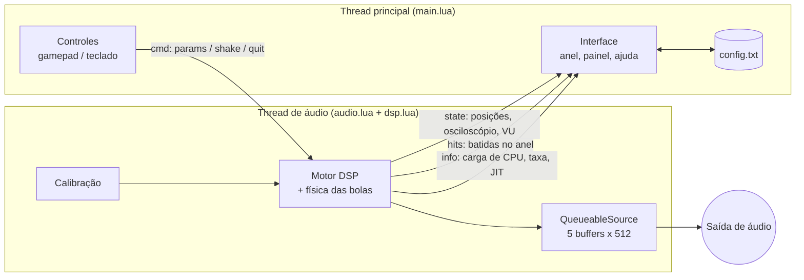
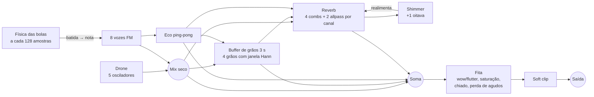

# Arquitetura

O ORBE tem duas partes que rodam em **núcleos diferentes** do processador:

## Por que duas threads

No R36S (CPU RK3326, 4× Cortex-A35), a primeira versão gerava o áudio no mesmo laço que desenhava a tela. Qualquer atraso no desenho virava um buraco no som. Agora:

- **`audio.lua`** roda numa `love.thread` própria. Ela mantém sempre **5 buffers de 512 amostras** na fila (~116 ms a 22 kHz) e dorme 4 ms entre as verificações.
- **`main.lua`** só desenha e lê os controles, limitada a **30 fps** para sobrar CPU.
- As duas conversam por **canais** (`love.thread.Channel`), sem memória compartilhada.

### Sincronizar imagem e som

O som que está sendo gerado agora só sai no alto-falante depois de ~116 ms, por causa da fila. Por isso, cada estado e cada batida enviados para a tela levam um carimbo `due` (o momento em que aquilo vai ser ouvido). A interface guarda esses eventos e só os mostra quando `due` chega. Entre um estado e outro, ela **extrapola** a posição das bolas pela velocidade, para o movimento ficar suave.

## Calibração automática

O LuaJIT tem problemas conhecidos para compilar código em ARM64. O próprio LÖVE tem uma solução paliativa para isso, e o resultado varia de aparelho para aparelho. Em vez de adivinhar, o `audio.lua` **mede** antes de começar a tocar:

1. Renderiza áudio de teste com **JIT ligado** e com **JIT desligado**, e fica com o mais rápido.
2. Se a carga a 22 050 Hz passar de **55%**, testa em ordem 16 kHz, 16 kHz leve, 11 kHz e 11 kHz leve, até achar uma combinação abaixo de 55%.
3. Durante o uso, se a carga passar de **85%** em duas medições seguidas, ativa o **modo leve** sozinho.

**Modo leve** = no máximo 5 vozes de nota (em vez de 8), 2 grãos (em vez de 4) e shimmer desligado.

## Motor de som (`dsp.lua`)

Escrito em **Lua puro**, com tabelas Lua indexadas a partir de 1. Isso fica rápido tanto no interpretador quanto com JIT. Arrays FFI do LuaJIT, que são muito lentos sem JIT, não são usados no laço por amostra.

### Física

- O anel tem raio 1, e as bolas, raio 0,045. Gravidade = parâmetro GRAVIDADE + inclinação do analógico.
- Ao bater na borda, a velocidade é refletida com um pequeno desvio aleatório (±3,5°), para nunca cair num laço perfeito.
- A velocidade de cada bola é puxada devagar para o valor de VELOCIDADE, o que mantém a energia estável.
- O **ângulo da batida em relação ao anel** (que gira) escolhe o segmento. Há `2 × (notas da escala)` segmentos, e a nota é `12·(oitava+1) + tônica + intervalo + 12·(volta)`.
- Cada bola só pode disparar uma nota a cada 70 ms.

### Vozes FM

Cada nota é uma síntese FM de 2 operadores com envelope de ataque e decaimento exponencial. O índice de modulação cai com o tempo, então o som começa brilhante e vai ficando puro.

| Timbre | Razão mod/portadora | Índice | Queda do índice | Ataque |
|---|---|---|---|---|
| SINO | 3,5 | 2,2 | 1,2 s | 4 ms |
| VIDRO | 7,0 | 0,9 | 0,35 s | 2 ms |
| CORDA | 1,0 | 3,2 | 0,12 s | 2 ms |
| SOPRO | 1,0 | 0,9 | 4 s | 350 ms |

Notas e moduladores que passariam da frequência de Nyquist descem de oitava automaticamente, para evitar *aliasing* e erros.

### Processamento em meia taxa

Drone, eco, reverb e shimmer são calculados **uma amostra sim, outra não**, com interpolação linear na saída. Como essas camadas são graves ou bem filtradas, a diferença não se ouve, e a economia de CPU é de ~40%.

### Shimmer

É um *pitch shifter* de dois cabeçotes que leem o buffer do reverb no dobro da velocidade, com janelas triangulares cruzadas. O resultado (uma oitava acima, suavizado) volta para a entrada do reverb com ganho baixo. O reverb é normalizado para manter o ganho do laço abaixo de 1.

### Fita

Linha de atraso de 1 024 amostras com a leitura modulada por wow (0,45 Hz), flutter (5,8 Hz) e uma deriva aleatória lenta. A posição é recalculada a cada 16 amostras. Depois vêm a saturação (*soft clip* racional), o chiado (ruído pré-calculado passado por um passa-altas) e um passa-baixas que fecha conforme o parâmetro FITA aumenta.

### Proteções

- Se aparecer `NaN` na saída, todos os buffers são zerados no mesmo bloco.
- `tools/stress.lua` testa todas as combinações de timbre, oitava e escala com todos os parâmetros no máximo, nas três taxas de amostragem.

## Desempenho medido (PC x86, por referência)

| Configuração | Sem JIT | Com JIT |
|---|---|---|
| 22 050 Hz completo | ~26× tempo real | ~95× tempo real |
| 16 000 Hz completo | ~40× tempo real | ~120× tempo real |
| 11 025 Hz leve | ~65× tempo real | ~150× tempo real |

O Cortex-A35 do R36S é, grosso modo, 20 vezes mais lento que esse PC sem JIT. Por isso a calibração escolhe a configuração no próprio aparelho.
